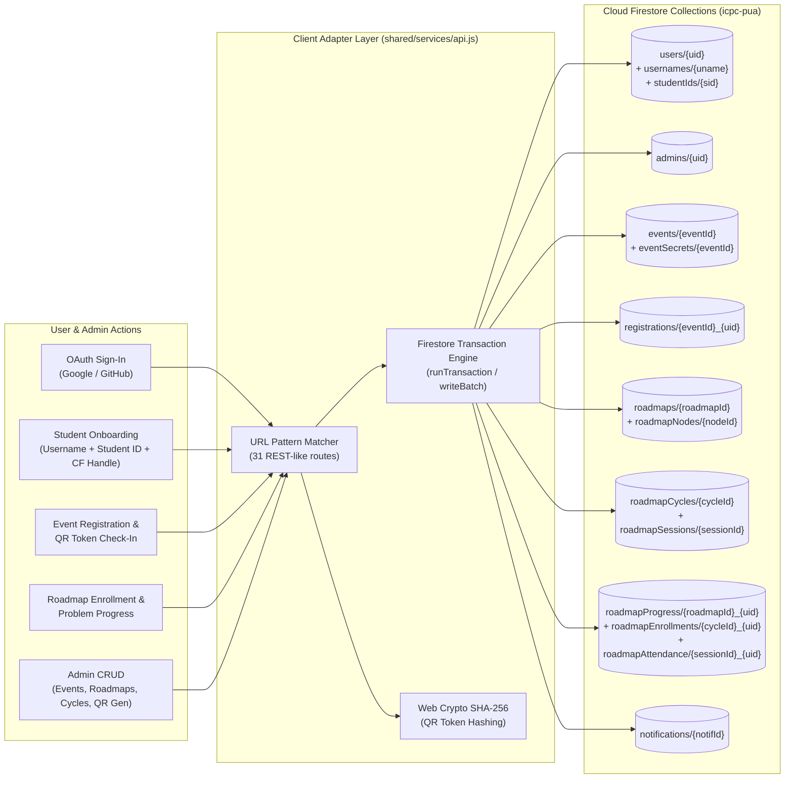

# Data Flow — ICPC-PUA Community Platform (Firestore Spark Adapter)

> Generated by Graphify on 2026-11-01. Last updated: 2026-11-01.

## Diagram

## Analysis Notes

- **Critical paths:**
  - **Uniqueness guarantees without a server:** Firestore does not have MongoDB's `{ unique: true }` index on arbitrary fields. We enforce uniqueness in `firestore.rules` via deterministic index collections: `usernames/{lowercaseUsername}`, `studentIds/{studentId}`, `registrations/{eventId}_{uid}`, `roadmapEnrollments/{cycleId}_{uid}`, `roadmapAttendance/{sessionId}_{uid}`, and `roadmapProgress/{roadmapId}_{uid}`.
  - **Secret isolation for QR tokens:** In MongoDB, `checkInTokenHash` used `select: false`. Since Firestore documents are read in full, QR token hashes are stored in `events/{eventId}` (`checkInTokenHash`) where SHA-256 preimage resistance prevents reversing a 32-byte random token, and verified during check-in by comparing `sha256(token) == event.checkInTokenHash`.
- **Risk areas:**
  - Leaderboard aggregation: Instead of running `$lookup` pipelines on every page load, each verified check-in transaction atomically increments `users/{uid}.attendancePoints` and `users/{uid}.verifiedAttendanceCount`, keeping `/events/leaderboard` to a single indexed query of `<= 100` user docs.
- **Stale/dead code suspects:**
  - Server-side `codeforcesVerification` challenge generator (`POST /auth/codeforces-verification/generate` and `/check`) is replaced with direct self-reported handle storage (`profile.links.codeforcesHandle`, status `unverified`).
