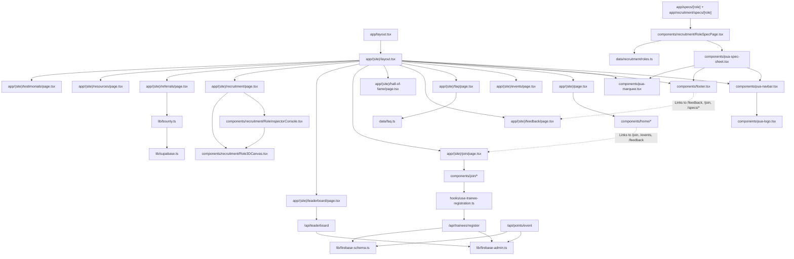

# Component Dependency Graph (PUA ICPC)

> Last updated: 2026-10-12.

## Diagram

## Analysis Notes

- **Hub nodes:** `app/(site)/layout.tsx` composes the shared chrome (`PuaNavbar`, `Marquee`, `Footer`) for every standard page; `PuaSpecSheet` composes the same chrome for the spec routes.
- **Shared logic:** `useTraineeRegistration` is consumed by both the home `JoinModal` and the `ApplicationSection` on `/join`.
- **Backends:** API routes depend on `lib/firebase-admin` and `lib/firebase-schema`; referral flows depend on `lib/bounty` -> `lib/supabase`.
- **Circular dependencies:** None. Route links are clean string hrefs.
