# Component Dependency Graph (PUA ICPC)

> Last updated: 2026-10-23.

## Diagram

```mermaid
graph TD
  ROOT["app/layout.tsx"]
  SITE_LAYOUT["app/(site)/layout.tsx"]

  PAGE_HOME["app/(site)/page.tsx"]
  PAGE_EVENTS["app/(site)/events/page.tsx"]
  PAGE_FAQ["app/(site)/faq/page.tsx"]
  PAGE_FEEDBACK["app/(site)/feedback/page.tsx"]
  PAGE_HOF["app/(site)/hall-of-fame/page.tsx"]
  PAGE_JOIN["app/(site)/join/page.tsx"]
  PAGE_LEADER["app/(site)/leaderboard/page.tsx"]
  PAGE_PROFILE["app/(site)/profile/page.tsx"]
  PAGE_RECRUIT["app/(site)/recruitment/page.tsx"]
  PAGE_REFERRALS["app/(site)/referrals/page.tsx"]
  PAGE_RESOURCES["app/(site)/resources/page.tsx"]
  PAGE_TESTIMONIALS["app/(site)/testimonials/page.tsx"]
  PAGE_SPECS["app/specs/[role] + app/recruitment/specs/[role]"]

  NAV["components/pua-navbar.tsx"]
  FOOTER["components/footer.tsx"]
  LOGO["components/pua-logo.tsx"]
  MARQUEE["components/pua-marquee.tsx"]
  SPEC["components/pua-spec-sheet.tsx"]
  ROLE_PAGE["components/recruitment/RoleSpecPage.tsx"]
  CONSOLE["components/recruitment/RoleInspectorConsole.tsx"]
  CARD["components/recruitment/role-card.tsx"]
  CANVAS["components/recruitment/Role3DCanvas.tsx"]
  CANVAS_SCENE["components/recruitment/role-canvas-scene.ts (lazy)"]
  SCENES["components/recruitment/role-scenes.ts"]

  HOME_SECTIONS["components/home/*"]
  JOIN_SECTIONS["components/join/*"]
  SPEC_SECTIONS["components/spec-sheet/*"]
  FAQ_SECTIONS["components/faq/*"]
  REFERRAL_SECTIONS["components/referrals/*"]
  FEEDBACK_SECTIONS["components/feedback/*"]
  LEADER_SECTIONS["components/leaderboard/*"]
  EVENT_SECTIONS["components/events/*"]
  BOUNTY["lib/bounty.ts"]
  BOUNTY_STORAGE["lib/bounty-storage.ts"]
  SUPABASE["lib/supabase.ts"]
  FAQ_DATA["data/faq.ts"]
  ROLE_DATA["data/recruitment/roles.ts"]
  FIREBASE_ADMIN["lib/firebase-admin.ts"]
  FIREBASE_CLIENT["lib/firebase/client.ts"]
  FIREBASE_SCHEMA["lib/firebase-schema.ts"]
  TRAINEE_SESSION["lib/trainee-session.ts"]
  API_AUTH["lib/api-auth.ts"]
  SYNC["lib/codeforces/sync.ts"]
  SYNC_RUNS["lib/codeforces/sync-runs.ts"]
  RATE_LIMIT["lib/rate-limit.ts"]

  ROOT --> SITE_LAYOUT
  SITE_LAYOUT --> NAV
  SITE_LAYOUT --> MARQUEE
  SITE_LAYOUT --> FOOTER
  NAV --> LOGO

  SITE_LAYOUT --> PAGE_HOME
  SITE_LAYOUT --> PAGE_EVENTS
  SITE_LAYOUT --> PAGE_FAQ
  SITE_LAYOUT --> PAGE_FEEDBACK
  SITE_LAYOUT --> PAGE_HOF
  SITE_LAYOUT --> PAGE_JOIN
  SITE_LAYOUT --> PAGE_LEADER
  SITE_LAYOUT --> PAGE_PROFILE
  SITE_LAYOUT --> PAGE_RECRUIT
  SITE_LAYOUT --> PAGE_REFERRALS
  SITE_LAYOUT --> PAGE_RESOURCES
  SITE_LAYOUT --> PAGE_TESTIMONIALS

  PAGE_HOME --> HOME_SECTIONS
  PAGE_JOIN --> JOIN_SECTIONS
  PAGE_EVENTS --> EVENT_SECTIONS
  PAGE_FEEDBACK --> FEEDBACK_SECTIONS
  PAGE_LEADER --> LEADER_SECTIONS
  PAGE_FAQ --> FAQ_SECTIONS
  PAGE_FAQ --> FAQ_DATA
  FAQ_SECTIONS --> FAQ_DATA
  CONSOLE --> ROLE_DATA
  PAGE_RECRUIT --> CONSOLE
  PAGE_RECRUIT --> CARD
  CARD --> CANVAS
  CARD --> ROLE_DATA
  CONSOLE --> CANVAS
  CANVAS -.->|"dynamic import"| CANVAS_SCENE
  CANVAS_SCENE --> SCENES
  PAGE_REFERRALS --> REFERRAL_SECTIONS
  PAGE_REFERRALS --> BOUNTY
  PAGE_REFERRALS --> BOUNTY_STORAGE
  BOUNTY_STORAGE -.->|"ScoutProfile type"| BOUNTY
  BOUNTY --> SUPABASE
  PAGE_LEADER --> API_LEADER["/api/leaderboard"]
  PAGE_PROFILE --> API_SESSION["/api/trainees/session"]
  PAGE_PROFILE --> API_CF["/api/trainees/codeforces"]
  PAGE_PROFILE --> API_CF_SYNC["/api/trainees/codeforces/sync"]
  PAGE_PROFILE --> FIREBASE_CLIENT

  PAGE_SPECS --> ROLE_PAGE
  ROLE_PAGE --> SPEC
  ROLE_PAGE --> ROLE_DATA
  SPEC --> SPEC_SECTIONS
  SPEC_SECTIONS --> ROLE_DATA
  SPEC --> NAV
  SPEC --> FOOTER
  SPEC --> MARQUEE

  API_REGISTER["/api/trainees/register"] --> FIREBASE_ADMIN
  API_REGISTER --> FIREBASE_SCHEMA
  API_LEADER --> FIREBASE_ADMIN
  API_LEADER --> FIREBASE_SCHEMA
  API_POINTS["/api/points/event"] --> FIREBASE_ADMIN
  API_POINTS --> FIREBASE_SCHEMA
  API_SESSION --> TRAINEE_SESSION
  API_SESSION --> API_AUTH
  API_CF --> TRAINEE_SESSION
  API_CF --> SYNC
  API_CF_SYNC --> SYNC
  API_AUTH --> TRAINEE_SESSION
  TRAINEE_SESSION --> FIREBASE_ADMIN
  SYNC --> FIREBASE_ADMIN
  SYNC --> SYNC_RUNS
  SYNC_RUNS --> FIREBASE_ADMIN
  API_REGISTER --> TRAINEE_SESSION

  HOME_SECTIONS -.->|"Links to /join, /events, /feedback"| PAGE_JOIN
  FOOTER -.->|"Links to /feedback, /join, /specs/*"| PAGE_FEEDBACK
```

## Analysis Notes

- **Hub nodes:** `app/(site)/layout.tsx` composes the shared chrome (`PuaNavbar`, `Marquee`, `Footer`) for every standard page; `PuaSpecSheet` composes the same chrome for the spec routes.
- **Feature sections:** Larger pages compose section components from their feature folder (`components/spec-sheet`, `faq`, `referrals`, `feedback`, `leaderboard`, `events`), matching the existing `components/home` and `components/join` convention.
- **Backends:** API routes depend on `lib/firebase-admin` and `lib/firebase-schema`; browser authentication uses `lib/firebase/client.ts`; referral flows depend on `lib/bounty` and `lib/bounty-storage` -> `lib/supabase`.
- **Auth and coordination:** private routes share `lib/api-auth.ts` and `lib/trainee-session.ts`; Codeforces work is owned by `lib/codeforces/*` and `lib/codeforces/sync-runs.ts`; authentication rate limits use `lib/rate-limit.ts`.
- **Circular dependencies:** None. Route links are clean string hrefs.
