# Component Dependency Graph — ICPC-PUA Frontend & Adapter

> Generated by Graphify on 2026-11-01. Last updated: 2026-11-01.

## Diagram

```mermaid
flowchart TD
    Main["src/main.jsx"] --> App["src/app/App.jsx"]
    App --> SiteLayout["src/app/layouts/SiteLayout.jsx"]
    App --> AuthPages["src/features/auth/pages/AuthPages.jsx"]
    App --> EventPages["src/features/events/pages/EventPages.jsx"]
    App --> LeaderboardPage["src/features/leaderboard/pages/LeaderboardPage.jsx"]
    App --> ProfilePages["src/features/profile/pages/ProfilePages.jsx"]
    App --> RoadmapsPages["src/features/roadmaps/pages/RoadmapsPages.jsx"]
    App --> StudentDashboard["src/features/dashboard/pages/StudentDashboardPage.jsx"]
    App --> NotificationsPage["src/features/notifications/pages/NotificationsPage.jsx"]
    App --> AdminLayout["src/features/admin/components/AdminDashboardLayout.jsx"]
    App --> AdminOverview["src/features/admin/pages/AdminOverviewPage.jsx"]
    App --> AdminEvents["src/features/admin/pages/AdminEventsPage.jsx"]
    App --> AdminRoadmaps["src/features/roadmaps/pages/AdminRoadmapsPage.jsx"]

    SiteLayout --> NotifBell["src/features/notifications/components/NotificationBellMenu.jsx"]
    RoadmapsPages --> LearningPath["src/features/roadmaps/components/LearningPath.jsx"]
    AdminRoadmaps --> LearningPath
    RoadmapsPages --> RoadmapUtils["src/features/roadmaps/utils/roadmapUtils.js"]
    AdminRoadmaps --> RoadmapUtils
    ProfilePages --> ProfileForm["src/features/profile/utils/profileForm.js"]
    AuthPages --> UsernameUtil["src/features/auth/utils/username.js"]

    SiteLayout --> ApiSeam["src/shared/services/api.js"]
    NotifBell --> ApiSeam
    AuthPages --> ApiSeam
    EventPages --> ApiSeam
    LeaderboardPage --> ApiSeam
    ProfilePages --> ApiSeam
    RoadmapsPages --> ApiSeam
    LearningPath --> ApiSeam
    StudentDashboard --> ApiSeam
    NotificationsPage --> ApiSeam
    AdminOverview --> ApiSeam
    AdminEvents --> ApiSeam
    AdminRoadmaps --> ApiSeam

    ApiSeam --> FBClient["src/shared/services/firebase.js"]
    ApiSeam --> FirestoreAdapter["src/shared/services/firestoreAdapter.js"]
    FirestoreAdapter --> FBClient
```

## Analysis Notes

- **Critical paths:**
  - `src/shared/services/api.js` is the single hub node (13 dependents, 77 call sites). Keeping its exported signature `api(path, { token, method, body, headers })` and `eventDate(value, options)` identical guarantees zero breaking changes across all 13 feature modules.
- **Risk areas:**
  - Zero circular dependencies detected (`0` cycles).
  - `AdminRoadmapsPage.jsx` (1,802 lines) and `ProfilePages.jsx` (960 lines) are large feature modules that rely heavily on nested response shapes from `/roadmaps/:slug` and `/auth/me`. The adapter must normalize Firestore documents to match the exact JSON shape previously returned by Express controllers.
- **Stale/dead code suspects:**
  - Google Identity Services (`window.google.accounts.id`) script loader in `AuthPages.jsx` is superseded by Firebase Auth `signInWithPopup` (GoogleAuthProvider + GithubAuthProvider), while preserving the UI layout.
