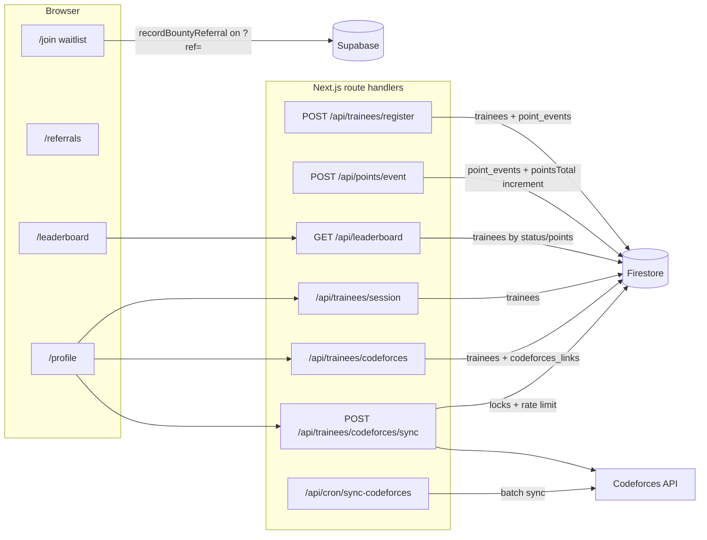

# Architecture overview

The PUA ICPC site is a Next.js App Router application that serves the public
marketing site, the cadet intake flow, the leaderboard, committee recruitment
spec sheets and the referral program. Human authentication uses Firebase
Authentication (email/password) and Firebase session cookies; administrators are
authorized by verified custom claims. Interactive pages are client components,
and server-side data access runs through Next.js route handlers.

## Stack

| Layer | Choice |
|---|---|
| Framework | Next.js 16 (App Router), React 19, TypeScript 5.7 (strict) |
| Styling | Tailwind CSS v4 with the tokens in `app/globals.css`; see `DESIGN.md` |
| Primary datastore | Cloud Firestore via `firebase-admin` (server-side only) |
| Identity | Firebase Authentication (client SDK) + Firebase Admin session cookies |
| Referral datastore | Supabase Postgres via `@supabase/supabase-js` (browser-side only) |
| External data | Codeforces official API (`user.info`, `user.status`) |
| 3D | Three.js, lazy-loaded for the recruitment role canvases |
| Tests | Vitest + Testing Library (unit), Playwright (browser) |

## Routes

| Route | Purpose |
|---|---|
| `/` | Landing page with roadmap, stats and a registration modal |
| `/events` | Training calendar with event detail modal (static data) |
| `/leaderboard` | Ranked active trainees, filterable by track, paginated, with the viewer's own rank |
| `/profile` | Trainee sign-in, linked Codeforces account, sync controls and personal standings |
| `/join` | Cadet intake form; accepts `?ref=CODE` for referral credit |
| `/hall-of-fame`, `/resources` | Community pages with static data |
| `/testimonials` | Placeholder page, intentionally not linked from the site chrome yet |
| `/faq` | Knowledge base rendered from `data/faq.ts` |
| `/recruitment` | Committee landing page with five specialization cards |
| `/referrals` | Scout enrollment, referral link and top-scout board |
| `/feedback` | Client-only feedback bucket |
| `/specs/[role]` and `/recruitment/specs/[role]` | Two aliases of the same role spec sheets, one page per key in `data/recruitment/roles.ts` |
| `POST /api/trainees/register` | Cadet registration; verifies the Firebase ID token, creates the trainee and issues the session cookie |
| `POST /api/points/event` | Append a point event and update the trainee total |
| `GET /api/leaderboard` | Ranked active trainees with pagination, track filters and the viewer's standing |
| `GET /api/leaderboard/me` | Signed-in trainee's global and track standings |
| `POST/DELETE /api/trainees/session` | Verify a Firebase ID token and create a session cookie / revoke and clear it |
| `POST /api/trainees/claim` | Bounded one-time legacy claim flow (disabled by default) |
| `GET/PUT/DELETE /api/trainees/codeforces` | Read the dashboard, link/change a handle, or disconnect |
| `POST /api/trainees/codeforces/sync` | Manual refresh for the signed-in trainee |
| `GET/POST /api/cron/sync-codeforces` | Machine-authenticated, time-budgeted batch refresh for Vercel Cron |
| `GET /api/health`, `GET /api/health/ready` | Liveness and bounded configuration/Firestore readiness |
| `/api/admin/*` | Admin-only sync, reconciliation/repair, sync-run reporting and claim codes |

Pages under `app/(site)/` share the navbar, marquee and footer defined in
`app/(site)/layout.tsx`. The two spec-sheet routes sit outside that group
because `PuaSpecSheet` renders its own chrome.

The spec-sheet routes are statically generated with `generateStaticParams` from
`roleSpecParams()`. Most pages under `app/(site)/` are client components because
they hold form, filter or fetch state; the recruitment landing page is a server
component.

## Data flows

**Cadet registration.** The public `/join` page and home modal are an
admissions waitlist, not an account-creation form. The
`POST /api/trainees/register` endpoint remains available to trusted intake
clients. It validates the fields, verifies a Firebase ID token (including
disabled-user checks), then writes the trainee, UID/email registries, optional
handle registry entry and the `registration_welcome` event in one transaction.
A supplied Codeforces handle reserves its normalized registry key but stays
pending until the Codeforces API confirms it. Retries from the same UID are
idempotent. See [data-model.md](../data-model.md) for the document shapes.

**Points.** `POST /api/points/event` accepts `universityId`, `type`, `points`,
`reason` and optional `metadata`. `type` must be one of
`POINT_EVENT_TYPES` and `points` must be an integer with
`|points| <= 1000`, otherwise the request is rejected with `400`. The handler
appends an immutable `point_events` document and increments `pointsTotal` (plus
`qrScansCount` or `attendedSessionsCount`) atomically. When `type` is `qr_scan`
and `metadata.qrCodeId` is present, a prior event with the same code is
rejected with `409` so a QR code cannot be claimed twice. Set
`POINTS_EVENT_SECRET` to require an `Authorization: Bearer <secret>` header;
without it the endpoint is open (development default).

**Trainee sessions.** `POST /api/trainees/session` verifies a Firebase ID token
with revocation checking, rejects disabled users and unlinked accounts, and
creates a Firebase session cookie. The cookie is HTTP-only, `SameSite=Lax`,
`Secure` in production and has an explicit lifetime. All private routes verify
it with `verifySessionCookie(cookie, true)`, resolve the trainee through
`trainee_auth_links`/`authUid` and distinguish `401` (unauthenticated) from `403`
(unlinked or insufficient permission). Existing trainees are linked by a
verified email plus a one-time university-id confirmation, or by the bounded
legacy claim code flow. Administrator routes additionally require the verified
`admin === true` claim. Sign-out revokes refresh tokens (account-wide) and
clears the cookie.

**Leaderboard.** `GET /api/leaderboard` queries `trainees` where
`status == "active"`, optionally filters by track, and orders by
`pointsTotal` descending with the document id as a deterministic tie-break.
Equal scores share a competition rank (`100, 100, 90` → `1, 1, 3`). The handler
computes ranks from the persisted sort order and aggregate counts, so a page
that starts inside a tie still reports the correct rank. It returns
`total`, `page`, `pageSize`, `totalPages` and a `viewer` standing for the
authenticated cookie, including when the viewer is outside the current page. The
page does not compute authoritative ranks in the browser and does not call
Codeforces.

**Codeforces synchronization.** `lib/codeforces/client.ts` calls only the
official API with a fixed base URL, timeouts, bounded retries with jitter and a
12 MB response cap. A Firestore transaction on
`system_state/codeforces_rate_limit` spaces requests at least two seconds apart
across instances. If that transaction fails, no Codeforces request is made and
the job reports a retryable coordination error (production never uses an
in-memory limiter). `cf_sync_locks/{universityId}` is acquired with bounded
retries and renewed by a heartbeat; every protected write re-checks the fencing
token and expiry in the same transaction, so a stale job cannot overwrite newer
results. A sync validates `user.info`, verifies the handle against the
`codeforces_links` registry, then pages through `user.status`, deduplicating
canonical problem keys and storing a cursor for incremental runs. Failures update
only status/error metadata, so the last successful rating and solved count
survive. Every attempt is recorded in `sync_runs`. `user.status` is never used
for source code.

**Referrals.** `lib/bounty.ts` calls Supabase directly from the browser, as
described in [data-model.md](../data-model.md).

**Feedback.** `/feedback` is entirely client-side: categories and messages are
React state and the list resets on reload.

## Background work and deployment

There is no worker process in the repository. Fleet-wide refreshes use the Vercel
Cron entry in [`vercel.json`](../../vercel.json) plus the machine-authenticated
`/api/cron/sync-codeforces` route (`CRON_SECRET` or `CF_SYNC_SECRET`). The cron
selects due accounts by `cfNextSyncAt` ascending and processes them within a
configurable time budget derived from the 60-second function limit, stopping at
a batch cap or before the deadline. Only success advances `cfNextSyncAt`, so an
interrupted invocation leaves unfinished accounts due. Opening
`/profile` also triggers a sync when the persisted `cfNextSyncAt` is due, and the
profile page exposes a manual refresh with a cooldown. This keeps the feature
usable on a deployment that cannot run scheduled jobs.

## Backend fallbacks

The app runs without credentials: when `adminDb` is `null`, registration and
point events are simulated, trainee sessions and Codeforces management answer
`503`, and the leaderboard serves hardcoded entries; when Firestore is reachable
but empty it serves the same seed entries; and `lib/supabase.ts` falls back to a
public project. The full contract is in
[configuration.md](../configuration.md).
