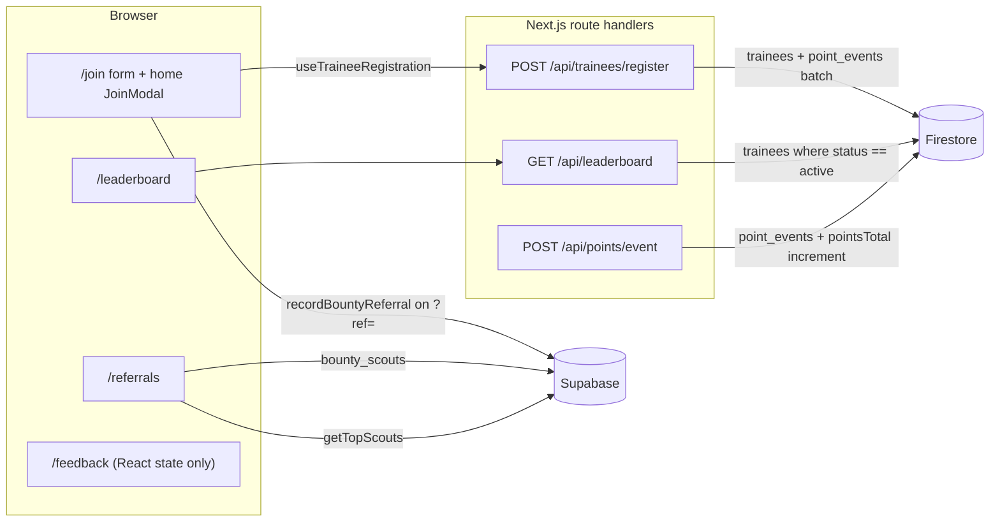

# Architecture overview

The PUA ICPC site is a Next.js App Router application that serves the public
marketing site, the cadet intake flow, the leaderboard, committee recruitment
spec sheets and the referral program. It has no authentication and no
server-rendered user sessions: interactive pages are client components, and the
only server code is three API route handlers.

## Stack

| Layer | Choice |
|---|---|
| Framework | Next.js 16 (App Router), React 19, TypeScript 5.7 (strict) |
| Styling | Tailwind CSS v4 with the tokens in `app/globals.css`; see `DESIGN.md` |
| Primary datastore | Cloud Firestore via `firebase-admin` (server-side only) |
| Referral datastore | Supabase Postgres via `@supabase/supabase-js` (browser-side only) |
| 3D | Three.js, lazy-loaded for the recruitment role canvases |
| Tests | Vitest + Testing Library (unit), Playwright (browser) |

## Routes

| Route | Purpose |
|---|---|
| `/` | Landing page with roadmap, stats and a registration modal |
| `/events` | Training calendar with event detail modal (static data) |
| `/leaderboard` | Live rankings with `all` / `level_1` / `level_2` filters |
| `/join` | Cadet intake form; accepts `?ref=CODE` for referral credit |
| `/hall-of-fame`, `/resources`, `/testimonials` | Community pages (static data; testimonials is a placeholder) |
| `/faq` | Knowledge base rendered from `data/faq.ts` |
| `/recruitment` | Committee landing page with five specialization cards |
| `/referrals` | Scout enrollment, referral link and top-scout board |
| `/feedback` | Client-only feedback bucket |
| `/specs/[role]` and `/recruitment/specs/[role]` | Role spec sheets; one route alias serves each role key in `data/recruitment/roles.ts` |
| `POST /api/trainees/register` | Cadet registration |
| `POST /api/points/event` | Append a point event and update the trainee total |
| `GET /api/leaderboard` | Ranked active trainees, filterable by track |

Pages under `app/(site)/` share the navbar, marquee and footer defined in
`app/(site)/layout.tsx`. The two spec-sheet routes sit outside that group
because `PuaSpecSheet` renders its own chrome.

The spec-sheet routes are statically generated with `generateStaticParams` from
`roleSpecParams()`; the home, events, leaderboard, join, referrals and feedback
pages are client components because they hold form or fetch state.

## Data flows

**Cadet registration.** Both the home `JoinModal` and the `/join` form share
`hooks/use-trainee-registration.ts`, which posts to
`/api/trainees/register`. The handler validates the required fields, rejects a
duplicate `universityId` with `409`, then writes `trainees/{universityId}` and a
`registration_welcome` event worth 10 points in one batch. See
[data-model.md](../data-model.md) for the document shapes.

**Points.** `POST /api/points/event` accepts `universityId`, `type`, `points`,
`reason` and optional `metadata`. It appends an immutable `point_events`
document and increments `pointsTotal` (plus `qrScansCount` or
`attendedSessionsCount`) atomically. When `type` is `qr_scan` and
`metadata.qrCodeId` is present, a prior event with the same code is rejected
with `409` so a QR code cannot be claimed twice.

**Leaderboard.** `/api/leaderboard` queries `trainees` where `status == "active"`,
ordered by `pointsTotal` descending, and derives rank, initials and avatar
colour in the handler. The page re-fetches when the track filter changes or the
user clicks refresh; there is no polling or live subscription.

**Referrals.** `lib/bounty.ts` calls Supabase directly from the browser.
`/referrals` creates or fetches a row in `bounty_scouts`, stores the profile in
`localStorage` under `pua_bounty_scout` and builds an invite link of the form
`/join?ref=CODE`. When a cadet registers with a code, `recordBountyReferral`
inserts into `bounty_referrals` and the scout's `recruits_count` is incremented
by a Postgres trigger that lives outside this repository. The Supabase client is
imported dynamically so `/join` does not pay for it unless a referral is
credited.

**Feedback.** `/feedback` is entirely client-side: categories and messages are
React state and the list resets on reload. There is no feedback API or storage.

## Backend fallbacks

The app is designed to run without credentials:

- If `firebase-admin` cannot initialise (`adminDb === null`), registration and
  point events return simulated successes and the leaderboard serves five
  hardcoded entries with `source: "local_cache"`.
- If Firestore is reachable but `trainees` is empty, the leaderboard serves the
  same entries with `source: "seed_defaults"`.
- `lib/supabase.ts` falls back to a public Supabase project when the
  `NEXT_PUBLIC_SUPABASE_*` variables are absent.

Environment variables, defaults and the fallback contract are documented in
[configuration.md](../configuration.md).

## Related docs

- [dependency-graph.md](./dependency-graph.md) — component import tree.
- [firebase-backend-plan.md](./firebase-backend-plan.md) — original design for
  the Firestore backend; check its status banner before relying on it.
- [data-model.md](../data-model.md) — stores and document shapes.
