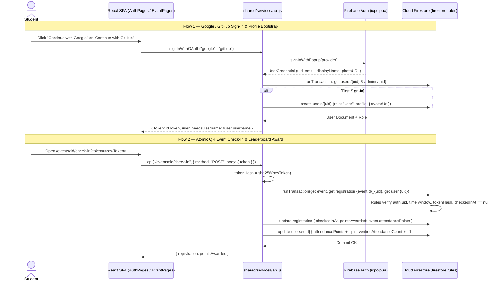

# Sequence Flows — OAuth Sign-In, Event QR Check-In, and Roadmap Progress

> Generated by Graphify on 2026-11-01. Last updated: 2026-11-01.

## Diagram

## Analysis Notes

- **Critical paths:**
  - Flow 1 ensures seamless session persistence via `onAuthStateChanged` while returning a shape compatible with `localStorage.getItem('token')` in `App.jsx`.
  - Flow 2 guarantees that a student cannot award themselves arbitrary points: `firestore.rules` validates that `request.resource.data.pointsAwarded == get(/databases/$(database)/documents/events/$(eventId)).data.attendancePoints`.
- **Risk areas:**
  - Popup blockers on mobile browsers during OAuth: fallback to `signInWithRedirect` if `signInWithPopup` throws `auth/popup-blocked`.
- **Stale/dead code suspects:**
  - Legacy `POST /api/auth/login` and `POST /api/auth/register` password endpoints are retained in the adapter only as compatibility shims for tests or redirected to OAuth.
