# State Machines — Authentication, Event Check-In, and Roadmap Lifecycle

> Generated by Graphify on 2026-11-01. Last updated: 2026-11-01.

## Diagram

```mermaid
stateDiagram-v2
    [*] --> Anonymous

    state "User Auth & Onboarding State" as AuthState {
        Anonymous --> OAuthPending: Click Google / GitHub Sign-In
        OAuthPending --> NeedsOnboarding: Firebase Auth uid created (no username/studentId)
        OAuthPending --> AuthenticatedStudent: Profile complete (role == user)
        OAuthPending --> AuthenticatedAdmin: admins/{uid} exists (role == admin)
        NeedsOnboarding --> AuthenticatedStudent: Submit unique username + 4-20 digit studentId
        AuthenticatedStudent --> Anonymous: Sign Out
        AuthenticatedAdmin --> Anonymous: Sign Out
    }

    state "Event & Check-In Lifecycle" as EventState {
        Draft --> Published: Admin publishes event
        Published --> RegistrationOpen: now < registrationDeadline && count < capacity
        RegistrationOpen --> Registered: Student registers (ticketId issued if offline)
        Registered -->RegistrationOpen: Student cancels before startsAt
        Registered --> CheckInWindowOpen: startsAt <= now <= endsAt && QR generated
        CheckInWindowOpen --> CheckedInAwarded: Student scans QR token (atomic +pointsAwarded)
        Published --> Cancelled: Admin cancels event
        Published --> DeletedArchived: Admin deletes (types exact title; preserves history)
    }
```

## Analysis Notes

- **Critical paths:**
  - Transition `OAuthPending --> NeedsOnboarding`: New Google/GitHub users start without a `username` or `studentId`. `App.jsx` redirects them to `/onboarding` until `username` (`^[a-z0-9_]{3,20}$`) and `studentId` (`^\d{4,20}$`) are claimed.
  - Transition `CheckInWindowOpen --> CheckedInAwarded`: Must only succeed once per `(eventId, uid)` when `startsAt <= now <= endsAt` and the SHA-256 hash of the QR token matches `event.checkInTokenHash`.
- **Risk areas:**
  - Race condition on concurrent check-in clicks: mitigated by storing `checkedInAt` on `registrations/{eventId}_{uid}` and enforcing in `firestore.rules` that `resource.data.checkedInAt == null` before transition to a non-null timestamp.
- **Stale/dead code suspects:**
  - Password change state (`PUT /auth/password`) is gracefully disabled/hidden for OAuth-only accounts since authentication is delegated to Google and GitHub.
