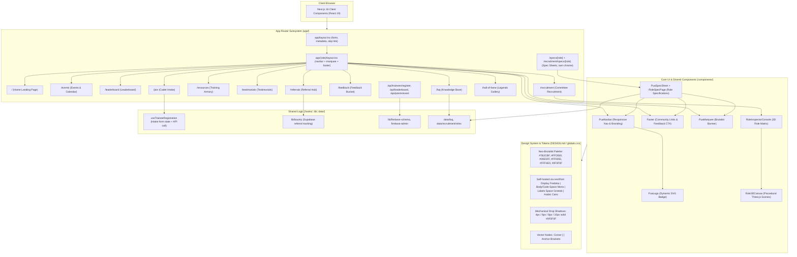

# System Topology (PUA ICPC / Code Strike)

> Last updated: 2026-10-12.

## Diagram

## Analysis Notes

- **Route groups:** All standard marketing pages live in `app/(site)/` and inherit the shared navbar, marquee, and footer from `app/(site)/layout.tsx`. The two spec-sheet routes stay outside the group because `PuaSpecSheet` renders its own dir-aware chrome.
- **Critical paths:** `PuaNavbar` and `Footer` serve as global site anchors; `useTraineeRegistration` is the single entry point for cadet intake from both the home modal and `/join`.
- **Backends:** Firestore (via `firebase-admin`) powers trainee registration, point events, and the leaderboard API; Supabase powers referral bounties in `lib/bounty.ts`.
- **Risk areas:** Keep Tailwind v4 `@theme` tokens and custom classes (`vector-node`, `btn-solid`, `shadow-solid`, `shadow-neo`, `stipple-bg`) consistent across new pages.
