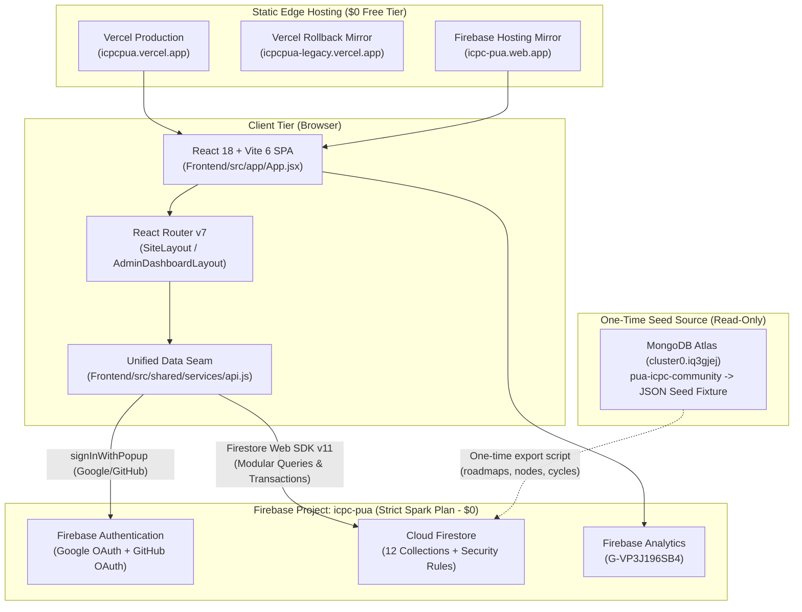

# System Topology — ICPC-PUA Community Platform (Firebase Spark + Vercel Architecture)

> Generated by Graphify on 2026-11-01. Last updated: 2026-11-01.

## Diagram

## Analysis Notes

- **Critical paths:**
  - `Frontend/src/shared/services/api.js` is the single orchestration seam serving all 77 frontend call sites across 31 logical route patterns.
  - Firebase Authentication (`icpc-pua`) issues verified ID tokens used directly by `firestore.rules` (`request.auth.uid`) to enforce student vs. admin access without a middleman Express server.
- **Risk areas:**
  - Firestore Spark daily quotas (50,000 document reads/day, 20,000 writes/day, 20,000 deletes/day). Mitigated by denormalizing leaderboard summaries and caching static roadmap trees per session.
  - Event & Session QR check-in concurrency: requires Firestore `runTransaction()` to atomically verify token hashes, prevent duplicate check-in (`registrations/{eventId}_{uid}` deterministic ID), and increment `registrationCount` / user points.
- **Stale/dead code suspects:**
  - `Backend/` Express server and `Backend/src/services/codeforcesVerificationService.js` become legacy reference/seed-export utilities once the Spark Firestore adapter is active, since Codeforces handles are now self-reported (`unverified`).
